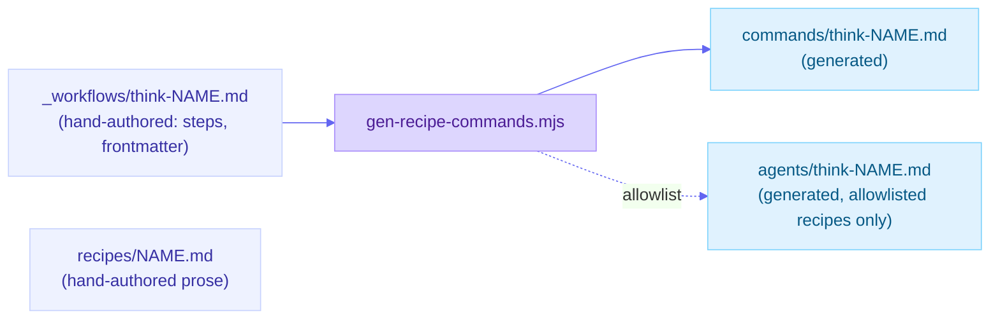

# Architecture internals

This page extends [Architecture](../architecture.md) (the overview: the two sources of truth, the generator table, and the fifteen-layer gate). It does not repeat that material. It goes one level deeper into three internals the overview names but does not unpack: the per-skill sidecar contract, the recipe-to-generated-surface pipeline, and the behavioral eval harness. Read the overview first.

## The per-skill sidecar contract

Every shipped framework lives in `skills/think-<method>/` and carries five files, each with one job:

| File | Job | Who reads it |
|---|---|---|
| `SKILL.md` | the agent-executable procedure, with frontmatter `name`, `description`, `metadata.{id, family, evidence-tier}` | the agent invoking the skill; `scripts/check-registry.mjs` (lifecycle truth, family validity) |
| `skill.meta.yml` | the routing sidecar: `identity` (id, slug, installable name, version, status, maturity), `classification` (primary family), and the quality stamps (`quality.trigger_eval_status`, `quality.output_eval_status`) | `scripts/gen-recommendable.mjs` (the advisor corpus); the eval harness, to find which skills are `not-run` vs `measured` |
| `evidence/dossier.md` | the graded sources and the honest "what the research does and does not show" note - the source of truth for the hand-authored evidence summary in `skill.meta.yml` | a contributor grading or re-grading a method; `scripts/check-registry.mjs` (the confirm-note ratchet) |
| `references/EXAMPLE.md` + `references/TEMPLATE.md` | a full worked run on the shared scenario, and the blank artifact shape | a user who wants to run the skill by hand with a pen; `scripts/check-example-coverage.mjs` |
| `eval/cases.md` | the trigger / anti-trigger / output-check cases, hand-authored in prose (`Should trigger`, `Should NOT trigger`, each anti case naming the correct alternative or `none`) | `scripts/eval-cases.mjs` (the static form gate); the eval harness's `extract-cases.mjs` (the behavioral measurement) |

`skill.meta.yml`'s own header states the thing worth repeating here: its shape may still be reconciled with agent-skills-toolkit conventions once more skills exist, and its evidence fields are a hand-authored *summary* of `evidence/dossier.md`, not generated from it. That is a deliberate single point of asymmetry in an otherwise generated-view repo (see the overview's "no second store" section) - the dossier is long-form prose a generator cannot safely compress, so the sidecar's evidence fields are reviewed by eye against the dossier rather than derived from it.

## The pure-lib / test pattern

Nearly every `scripts/check-*.mjs` gate layer is a thin CLI wrapper around a `scripts/lib/*-lib.mjs` module that holds the actual rule as pure functions: `lifecycle-lib.mjs`, `workflow-mirror-lib.mjs`, `manifest-roster-lib.mjs`, `confirm-notes-lib.mjs`, `contested-lib.mjs`, `count-surface-lib.mjs`, `tier-claim-lib.mjs`, `warning-count-lib.mjs`, `route-parity-lib.mjs`, `example-coverage-lib.mjs`, `doi-sweep-lib.mjs`, `research-appendix-lib.mjs`, and more under `scripts/lib/`. The split exists so each rule can be unit-tested directly, with a synthetic fixture, instead of only being exercised end to end against the real tree - a guard that is only ever run against the repo it polices can pass by accident if the repo and the guard both have the same blind spot. `tests/*.test.mjs` is where that direct coverage lives; `npm test` runs all of it with Node's built-in test runner.

## The recipe-to-generated-surface pipeline

A recipe starts as one hand-authored file and fans out to up to three generated ones:

`_workflows/think-<name>.md` carries the chain as data (frontmatter `name`, `description`, `steps: [think-a, think-b, ...]`) plus a short hand-written explanation of why that order and what to carry forward between steps. `recipes/<name>.md` is the fuller hand-authored prose for the same recipe, cross-linked from the `_workflows/` file. `scripts/gen-recipe-commands.mjs` reads the `_workflows/` frontmatter and emits a `commands/think-<name>.md` that carries the chain verbatim, so invoking the recipe as a command cannot drift from the chain it is named for; `--check` byte-compares the committed output against a fresh run (gate layer 5 in the overview's gate list). A second, smaller allowlist of recipes also gets a generated subagent under `agents/` that preloads exactly that chain's skills - `agents/_chain-permitted.yaml` is the registry of which invocation edges are permitted, and both the command and the (allowlisted) agent are regenerated from the same source, never hand-edited.

## The eval harness (behavioral, not structural)

The gate's layer 2 (`scripts/eval-cases.mjs`) only checks that every `eval/cases.md` is well-formed and name-safe - it is a **form** check, deterministic, and runs on every PR. `scripts/eval/` is a separate, **model-executed** harness that measures whether the catalog actually routes correctly; it is not a gate layer; the architecture overview's gate list explicitly does not include it. It runs three measurements:

- **Trigger eval** - pools every skill's "Should trigger" and "Should NOT trigger" cases, has blind router agents (no answer key, no authorship) route each prompt against the public advisor catalog, then a deterministic scorer (`score.mjs` / `score-lib.mjs`) grades top-1 and top-3 against the expected skill or named alternative.
- **Output eval** - runs a skill for real and checks the artifact it produces against per-skill structural checks (`score-output.mjs`).
- **Skill-selection eval** - a different, closed-book question: given only a name and description (no anti-triggers, no overlaps), does the Framework Advisor still pick the right skill (`score-selection.mjs`).

Each measurement is a Workflow script (`route.workflow.mjs`, `output.workflow.mjs`, `skill-selection.workflow.mjs`) that produces a **scorecard**, committed as a paired `.md` + `.json` under `docs/internal/eval-results/`, dated and (from 2026-10-14 onward) carrying `provenance.model`, `modelTier` and `casesSha` so a later reader can tell which model produced a figure and whether the case set it ran against has since changed. `scripts/eval/check-eval-freshness.mjs` is the only half of this that the gate does run: it checks the scorecard pairing and shape (`npm run eval:freshness`), never the figures themselves - re-measuring behavior is a human decision, made on behavior-affecting releases, not something CI triggers.

## See also

- [Architecture](../architecture.md) - the overview this page extends.
- [Run the conformance gate locally](../how-to/run-the-conformance-gate-locally.md) - the gate layers named above, from the outside.
- [`scripts/eval/README.md`](../../scripts/eval/README.md) - the full eval harness operator guide (the blind/answer-key split, the open-book caveat, widening an answer key).
