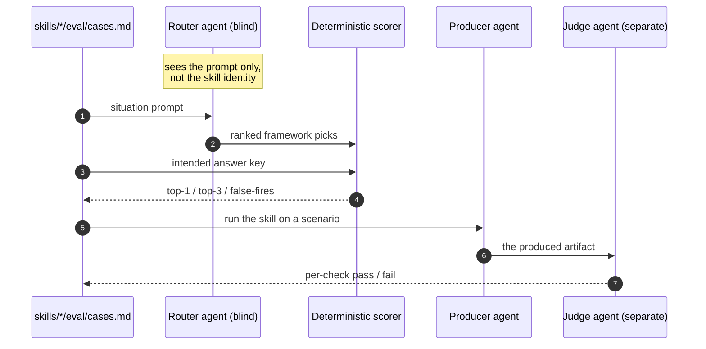

import { Card, CardGrid, Aside, Badge } from '@astrojs/starlight/components';

Most thinking-tool collections ask you to take their value on faith. This library measures two things you can check, and publishes the raw results.

<Aside type="caution" title="The honest frame first">
These are thinking *aids*, not magic. The evidence that any given method improves a real-world decision is graded honestly on every framework page, and is often weaker than the method is usually sold on (see [the evidence model](../evidence-model/)). What the two evals below measure is narrower and more checkable: does the right framework fire for a situation, and does a framework, once run, produce the artifact it promises. They do **not** measure whether the artifact made your decision turn out better.
</Aside>

## The three questions a library like this must answer

<CardGrid>
  <Card title="Does the right tool fire?" icon="random">
    If you describe a situation, does the catalog route you to the framework that actually fits, and stay quiet when no tool fits? This is what the [Framework Advisor](../../tools/think-framework-advisor/) depends on. Measured by the **trigger eval**.
  </Card>
  <Card title="Is the output any good?" icon="document">
    When a framework runs, does it produce a structured artifact that meets its own quality checklist, not a wall of prose? Measured by the **output eval**.
  </Card>
  <Card title="Does the front door get found?" icon="rocket">
    Before any of that: out of every skill an agent has installed, does it reach for *this* library's entry point at all? A catalog that routes perfectly is worthless if nothing ever opens it. Measured by the **skill-selection eval**, which is a different question against a different corpus - and is reported separately below, never blended with the other two.
  </Card>
</CardGrid>

## Trigger eval: the catalog routes cleanly

Every trigger and anti-case from all **63 skills'** own `eval/cases.md` was pooled into one blind answer key. Blind router agents - which never see which skill authored a case - routed each situation against the public advisor catalog, exactly as the live advisor does. A deterministic scorer graded routed-versus-expected. For the 376 should-fire cases the routers never see the expected answer either. For the 379 anti-cases they effectively do in the shipped catalog, so on 2026-10-20 the anti-cases were also routed against a catalog with those lines removed. The caution under the cards gives the result.

<CardGrid>
  <Card title="0 false-fires" icon="approve-check">
    Across **379 anti-cases** (deliberately wrong-tool or no-tool situations), no skill wrongly grabbed one. **100%.** This is the metric that matters most: skills that do not over-trigger. Earlier runs measured it open-book. On 2026-10-20 it held at 379 of 379 with the leaked test lines removed from the catalog, so it is now measured closed-book too.
  </Card>
  <Card title="100% top-1, 100% top-3" icon="approve-check">
    Of **376 "should fire" situations**, all 376 routed to the intended framework on the first pick - on 2026-09-10, on 2026-09-13, and again on 2026-10-20, the first run on Opus 5.5. The run before those scored 373 of 376; the three misses were near-twins that still carried the intended skill in the top 3. Treat the difference as run-to-run variance, not progress - see below.
  </Card>
</CardGrid>

<Aside type="caution" title="The anti-case figures were open-book; a closed-book run kept zero false-fires (2026-10-20)">
The catalog the routers read is built partly from the eval's own test cases. Each skill's `eval/cases.md` lists situations where it should **not** fire, and the build copies those lines, word for word, into the catalog as that skill's anti-triggers. So every anti-case prompt was in front of the router, filed under the skill it must not pick. For the 144 anti-cases that name a better tool, the line names that tool too.

- **Not affected:** the 100% top-1 figure. Should-fire cases never appear in the catalog. The skill-selection eval further down is not affected either, because its routers see only names and descriptions.
- **Affected:** the zero-false-fire figure, and the right-alternative count (whether an anti-case went to the better tool it names).
- **The closed-book run (2026-10-20):** the same 755 cases were routed twice on the same day and model, once against the shipped catalog and once with the copied anti-trigger lines removed and nothing else changed. False fires: **0 of 379 in both**. Right-alternatives: **141 of 144** with the lines and **137 of 144** without. Two runs of the shipped catalog, scored on the same answer key, differ by only one case, so the copied lines probably supply about three of those answers. The closed-book right-alternative figure is **137 of 144 (95.1%)**.
- **The earlier bound:** on 2026-09-11 a run removed all three hint fields together, including hints that were never leaked, and scored **378 of 379** on false fires. That was an upper estimate. The 2026-10-20 run removed only the leaked lines.

Read "zero false-fires" as measured closed-book on 2026-10-20, on one run per arm, and read the right-alternative count as partly open-book. The [experiment record](https://github.com/product-on-purpose/thinking-framework-skills/blob/main/docs/internal/experiments/2026-10-20-anti-triggers-closed-book.md) has the design and every case that moved.
</Aside>

The headline: **100% top-1 routing on 376 should-fire cases, measured closed-book**, across all 63 skills, and **zero false-fires on 379 anti-cases, measured closed-book on 2026-10-20**. The catalog discriminates - the descriptions send a situation to the right framework, and the anti-triggers keep neighbours apart.

**This run is a reproduction, and that is the point of showing it.** The trigger eval was re-run on 2026-09-10 against a byte-identical catalog and case set - the routing corpus has not changed since 2026-06-19 - so nothing about the library moved between the two runs. What changed: top-1 went 373/376 to 376/376, and right-alternative went 123/128 to 122/128. That is **run-to-run variance in a model-executed measurement**, not the catalog improving, and reading it as improvement would be a mistake. The number that matters held exactly: **zero false-fires, both times.**

**A third run on 2026-09-13 returned 376 of 376 and zero false-fires again.** The routing corpus had changed slightly by then - one skill's description was corrected - so this is not a fourth reproduction of an identical setup, and it is reported as what it is: the same headline figures against a catalog that moved by one entry. Worth noting that this corpus is the *steadier* of the two measured here; the skill-selection corpus below does not reproduce as cleanly, and that difference is itself a finding.

**A fourth run on 2026-10-20, the first on Opus 5.5, returned 376 of 376 and zero false-fires again.** It is also the first run that records its model and fingerprints the cases it measured. The earlier runs recorded neither, and a different model is a different instrument, so this run starts a new baseline rather than extending a trend. Its right-alternative count was 141 of 144. The 2026-09-13 run scored 137, but on 2026-10-17 three of its misses were widened to accept the tool it picked. Scored on today's answer key, it would be 140, so the soft figure moved by one case.

## Output eval: the artifacts hit their own bar

A separate measurement. For each of the **63 skills**, a producer agent runs it on a real prompt and emits the full artifact; a *separate* judge agent grades that artifact against the skill's own "output checks," check by check, so nothing grades itself. Here is how the blind eval harness routes and scores:

<CardGrid>
  <Card title="426 of 429 checks passed" icon="approve-check">
    **99.3%** of individual output checks passed across freshly produced artifacts, re-measured **2026-10-20**, the first output run on Opus 5.5. **60 of 63** skills satisfied every single check. The run before it scored 424 of 429 with 58 of 63 perfect - so this is **higher**, and the next card is about why that is not a story of improvement.
  </Card>
  <Card title="The number went up, and that is not progress" icon="information">
    Three things changed since the 2026-09-12 run: the model that produces and grades every artifact, the skills themselves (more than 30 procedure and template files), and the wording of two checks. The judge's instructions did not change, and it still opens the file behind any claim an artifact makes about another skill. With three variables moving at once, the difference belongs to none of them, so this is a **new baseline on a new model**, not an improvement.
  </Card>
</CardGrid>

**What failed, since that is the useful part.** Each of the three failures is specific: a five-whys chain that flagged its own branches and redirected correctly, then offered a hedged countermeasure anyway; a reversibility classification that named the deciding dimension for a borderline case but declined to say which way it leans; and a pairwise ranking that stated its comparative question once, then judged one pair for a different reader than the rest. Each skill's procedure instructs the behaviour its check asks for, and each skill passed that check in every earlier run.

**No output check has failed twice.** Across every output scorecard since 2026-06-10, 16 distinct checks have failed, and none has failed in a second run. All five 2026-09-12 failures passed on 2026-10-20. One of those five was a real defect, caught because the judge opens files: `think-qualitative-comparative-analysis` had claimed that process tracing "is a method, not a shipped skill here", and `think-process-tracing` ships, at tier P. It was fixed in September. The other failures scatter across skills from run to run, which is what run-to-run variation looks like. So read the last few checks of this figure as noise, as with the skill-selection digit below.

**A higher number under a blinder grader would be worth less.** That is why the strict judge stayed in place for a run on a new model.

## Skill-selection eval: does the front door get found?

The two evals above both assume you have already arrived. They ask *which framework fits* and *is the artifact good* - and both route against the advisor's catalog of 63 frameworks. Neither can tell you whether an agent with 77 tools installed reaches for this library in the first place.

That took a different instrument, because the first one was structurally blind to it: the framework catalog contains no meta-skills (correctly - it is the advisor's list of things to *recommend*), so a router reading it can never return `think-framework-advisor` as a pick. The four entry-point tools were not failing that eval. They were invisible to it.

<Aside type="caution" title="Read this number separately from the two above">
This eval routes against the **installed roster** - 67 skills plus 10 commands, each reduced to the name and description an agent actually sees - not against the enriched 63-framework catalog. Different corpus, different question, different case count. The figures are **not comparable** with the trigger eval's and are deliberately not combined into a single headline.
</Aside>

<CardGrid>
  <Card title="16 of 17 for the front door" icon="approve-check">
    Across the four entry-point tools' own trigger cases, **16 of 17** routed to the intended tool on the first pick (**94.1%**), with **zero false fires** among them. The single miss is one advisor case - *"Should we launch a free tier? I'm nervous we're committing because it's the obvious move"* - which reads to a router as a decision to pressure-test rather than a request for routing. On 2026-10-20 a router sent it to the stress-test-decision recipe command, which is exactly that reading. A defensible miss, and still a miss.
  </Card>
  <Card title="One false fire across the whole roster" icon="warning">
    Over all **794 cases**: **392 of 393** top-1 (99.7%), and **399 of 400** anti-cases drew no false fire - which is **not** a clean sweep. `think-pairwise-comparison` grabbed *"I have twenty candidates to rank by forced pairwise comparison"*, an anti-case whose own prompt names the tool. Debatable on the merits; counted anyway.
  </Card>
</CardGrid>

**Why that second card exists.** The trigger eval's zero-false-fire result holds at 379 of 379, open-book and, since 2026-10-20, closed-book (see the caution above). This one is a different corpus: a router here sees only names and descriptions, never the test prompts. It would be easy to let the friendlier number stand for the whole library and leave this one out. But the two evals ask different questions of different corpora, and on *this* corpus the answer is 399 of 400, not 400 of 400. Quoting only the friendlier figure is the exact move a page like this exists not to make.

**Read the last digit as noise, because we measured how much noise there is.** This exact measurement - same 794 prompts, same roster, same model - was run three times on Opus 5: once on 2026-09-10 and twice on 2026-09-13. Top-1 came back **391, 392, 392**. On the two runs where *nothing whatsoever changed between them*, **15 of the 794 picks still disagreed**, one of them flipping from wrong to right. A fourth run on 2026-10-20, on Opus 5.5, returned **392** again.

So this instrument reproduces to within about one case, and the final digit of that percentage is not a fact about the library. Earlier versions of this page published a single run's figure with no indication of that, which invited exactly the kind of trend-reading the number cannot support.

What does **not** move across all four runs, on two models: **399 of 400** on the anti-cases, **one** false fire, and the *same* false fire each time. The front-door figure does not move either - **16 of 17** with zero false fires, four times identically. Those are the figures to hold this library to. A one-case difference in the top-1 count is not evidence of anything.

**The added commands did not steal selections.** v0.14.0 shipped nine always-loaded recipe commands, which raised a fair worry that more description surface would degrade routing. In this corpus they compete directly against all 67 skills. On 2026-09-13, across 794 cases, commands took the top pick **twice** (0.25%). On 2026-10-20 they took it **once**, on the front-door miss above, and appeared somewhere in the top 3 on 156 cases. Visible to a router, and almost never winning.

**All four entry-point tools now have both halves measured.** Their artifacts were graded too: the three that a generic produce-then-judge harness can measure scored **20 of 20** checks (2026-09-11), and the fourth - the research engine, which dispatches to a subagent and whose own instructions forbid running research inline - needed a purpose-built dispatch harness and scored **6 of 6**, one of those decided by running a schema validator rather than by a model judge.

**What it does not prove.** Seventeen trigger cases is a small N, and they are self-authored. It is a first baseline for a question that had no instrument at all until 2026-09-10, not a settled property. It has now held identically across four runs on two models (Opus 5 and Opus 5.5), which rules out *this instrument's* day-to-day variance as the explanation but says nothing about a wider case set.

## The 7 contested lenses are folded into these numbers

The catalog is **63 skills total: 56 evidence-graded core skills + 7 contested lenses**. The contested lenses are famous frameworks with weak or mixed empirical evidence (SWOT, Five Whys, and similar), added in v0.11.0 and shipped caveat-first as explicit-request-only skills. Earlier runs scored them as a separate cohort; every run since 2026-06-25, including the 2026-10-20 one above, pools all 63 skills into one answer key, so the numbers above already include them.

<CardGrid>
  <Card title="They never grab a generic prompt" icon="approve-check">
    The zero-false-fire result above includes the contested lenses, open-book and closed-book: not one grabbed a generic situation. That is exactly how explicit-request-only is meant to behave - a contested lens fires only when the user names it directly, and routes elsewhere otherwise.
  </Card>
  <Card title="Their caveats hold under the judge" icon="approve-check">
    Each contested lens still leads with its caveat-first contract before running the framework, and its artifact passed the same blind judge as every core skill. Weak method evidence (graded honestly per page) is a separate axis from whether the skill routes and produces cleanly.
  </Card>
</CardGrid>

A behavioral score is not an evidence claim. A contested lens can route correctly and produce a clean caveat-first artifact while its underlying method evidence stays weak. For evidence grading, the **56 core skills remain the baseline** and the contested lenses are graded low on their own pages; the unified run above measures only routing and artifact quality across the whole catalog. See [the evidence model](../evidence-model/) and each dossier for the method grade.

## What this does **not** prove

<Aside type="note" title="The limits, stated plainly">
- The evals measure **routing** and **artifact quality**, not real-world **decision outcomes**. A premortem that surfaces five sharp risks is a good artifact; whether it made your launch succeed is a different, harder question the dossiers are honest about.
- They are **model-executed and non-deterministic** - a snapshot, not a fixed property. One skill failed a check in a pilot and passed it in the full run. They are a measurement, not a gate.
- **The evals carry their own corpora and are not blended.** On **2026-10-20**, framework routing (755 cases, plus the closed-book arm), skill selection (794 cases, a different corpus) and all 63 skills' artifacts (429 checks) were each re-run on Opus 5.5. The meta-skills' artifacts were last graded **2026-09-11**. Each is reported under its own corpus above, and none is combined with another into a single headline. These superseded the earlier split cohorts (56 core skills 2026-06-17, 7 contested lenses 2026-06-19).
- **The output figure is not comparable with the runs before it, and we say so rather than charting a trend.** 428/429 (2026-06-25), 424/429 (2026-09-12) and 426/429 (2026-10-20) each differ from the run before in more than one way. Between the first two, the grader and the skills changed. Between the last two, the model, the skills and two check wordings changed. With two or more variables moving, no difference is attributable, in either direction. Anyone drawing a line through those points is reading noise and instrument changes as a trend.
- **Only the 2026-10-20 runs record both their model and the cases they measured.** Before them, the framework-routing scorecards recorded no model, and no scorecard fingerprinted its cases, so the 2026-09-10 trigger figures are a reproduction of the *measurement*, not a controlled comparison against a known baseline model. Since 2026-10-14 every new scorecard must record both, and the library's conformance gate rejects one that does not. The 2026-10-20 runs are the first to do so, which makes them the first baseline a later run can be compared against for a known model and a known case set.
</Aside>

## Check it yourself

<CardGrid>
  <Card title="The methodology" icon="open-book">
    How the blind routers, answer keys, and scorers work is documented in the harness ([`scripts/eval/`](https://github.com/product-on-purpose/thinking-framework-skills/tree/main/scripts/eval)). It runs without an API key and is reproducible.
  </Card>
  <Card title="The raw results" icon="document">
    The full per-skill scorecards and machine records live in the repo ([`docs/internal/eval-results/`](https://github.com/product-on-purpose/thinking-framework-skills/tree/main/docs/internal/eval-results)) - every number above traces to a scorecard file you can audit.
  </Card>
  <Card title="The evidence behind each method" icon="approve-check">
    Separately from behavior, every framework carries a graded dossier. Trace any claim to its source in [the bibliography](../../evidence/bibliography/).
  </Card>
  <Card title="How a page is built" icon="setting">
    The pages are generated from the skills, so the docs cannot drift from what runs. See [how to read a page](../how-to-read-a-page/).
  </Card>
</CardGrid>
